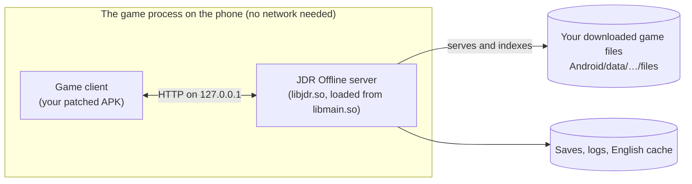

<div align="center">

# JDR Offline

**JoJo's Bizarre Adventure: Diamond Records, playable offline and in English, with your progress kept on your device.**

A preservation project for Bandai Namco's JoJo's Bizarre Adventure: Diamond Records (Android, version 3.12.0).

No download: you turn your own copy of the game into the offline version on your PC.
[Player setup →](docs/PLAYER-SETUP.md)


[](LICENSE)

[Quick start](#getting-started) · [Player setup](docs/PLAYER-SETUP.md) · [Status](#status) · [Architecture](docs/ARCHITECTURE.md) · [Roadmap](docs/ROADMAP.md)

</div>

---

## What is this

Diamond Records needs Bandai Namco's servers to start, and those servers are gone. The game itself still ships
almost everything else: the battles, the menus, the characters and their animations, the story. What is missing is
the backend it talks to, and the files that backend handed out: the asset manifest, the master tables and the keys
for the encrypted protocol.

JDR Offline reimplements that backend as a small Rust server (`libjdr.so`) that runs **inside the game process**. A
patcher adds it to **your own** copy of the game, on your own computer. On the phone, the server rebuilds what the dead
backend used to send, answers every request the game makes, and serves your own game files. The result is an APK that
plays with no internet connection, in English.

The repository contains no game files. You bring your own APK and game data; the project brings the server and the
patcher. Multiplayer is not part of it: the clan room is hidden, and PvP and raid rescue use local stand-ins.

## Features

**Play offline**

- Boots to the title, logs in and reaches My Page with no internet connection and no Bandai Namco servers.
- The asset manifest, the startup tables and the game's master tables are rebuilt on the phone from the content in
  [server/content](server/content).
- Saves stay on the device, with a backup copy outside the app's private storage.

**In English**

- Menus, item, statue and Mind names, skills, the story and the in-APK messages, retranslated in the style of an
  official localization.
- Redrawn UI art for the text that is baked into images, as a separate art pack you patch in.
- Portraits for the statues that never had one in the player's files.

**Tactical battles**

- Turns, damage, skills and cool turns, leader, assist and Mind abilities, Reversal, chains, the boss intro, the win
  screen and stage missions, with values rebuilt from public community wikis.
- The original's battle camera: attacks on the game's own two-shot, skill and SP cuts measured on 223 actions of the
  original footage, and the still win shot.

**Action battles**

- Enemy waves on the stage's spawn points, plus attack, skill, SP and finisher.

**Collection and economy**

- Statues (real stats for 206 of 292, from the wikis), Minds, the growth tree, enhancement, Mind equipment, assists,
  and the team and My Page screens.
- Missions, the Message Box, items and exchanges, free summons (statue, Mind, box and Count Up), story, daily and event
  quests, the Labyrinth, the Arena against local teams, and the Town with AI members.

**A lighter APK**

- Crash reporting, analytics, ads, push notifications and Play Games are removed.

**For tinkerers**

- A standalone server for a PC: run the URL-patched game against it over `adb reverse` and watch every request.
- Per-service protocol notes, and research reports from the disassembly and the original footage.

## Status

Current build: **41**. The game boots offline on a Samsung Galaxy S22 (Android 16), reaches My Page, plays tactical
battles and shows the English text and art. Every build lists what changed and what to check on a phone in
[docs/STATUS.md](docs/STATUS.md). Nothing counts as fixed until a device log or recording shows it.

| Goal | Status |
|---|---|
| Offline boot, login and My Page | Works (tested on a phone) |
| Asset manifest and master tables rebuilt on the phone | Works (tested on a phone) |
| Saves kept on the device | Works (tested on a phone) |
| English menus, names and redrawn art | Works (tested on a phone) |
| Portraits for statues without one | Works (Build 31, tested on a phone) |
| Tactical battles: turns, damage, skills, win screen | Works (tested on a phone) |
| Battle camera: attacks, skills and the win shot | Works (Builds 39 and 40, tested on a phone) |
| Action battles (with leader and assist abilities, JoJo Links, SP cinematics) | Built (Build 41), waiting for a phone test |
| Town home over the realtime socket | Works (Build 26, tested on a phone) |
| Missions, Message Box, summons, Labyrinth, Arena, events | Built; partly tested on a phone |
| Lighter APK (no crash reporting, ads, Play Games) | Works (Build 32, tested on a phone) |
| Multiplayer (clan room, PvP, raid rescue) | Not planned: local stand-ins only |

## How it works

The game talks to its backend over HTTP with an encrypted envelope, and downloads its master tables and asset list
from it at start-up. The patched APK points the game at `127.0.0.1`, where the embedded server answers.



1. `jdr-tool keys` recovers the keys the dead server used to hand out from your own downloaded files and writes them to
   a local `keys.json`, which is never committed.
2. `jdr-patch` applies a set of fingerprinted patches to your APK, each of which can be switched off: point the game at
   `http://127.0.0.1`, embed `libjdr.so`, remove the 32-bit libraries, fix Unity 2018's allocator crash on Android 11+,
   keep the downloaded files, let the Town connect without DNS, strip the online SDKs, and put the English text and the
   redrawn art in the APK. It then re-signs the APK with your own key and writes a patch report.
3. On the phone, the server speaks the game's encrypted protocol, serves your own files, and generates everything a
   player copy lacks (the manifest, the master tables and the English bundles) from `server/content`.

More: [docs/ARCHITECTURE.md](docs/ARCHITECTURE.md) and the research notes in [docs/research/](docs/research/).

## Getting started

### For players

The full guide, with every command: **[docs/PLAYER-SETUP.md](docs/PLAYER-SETUP.md)**.

You need:

- your own APK, version **3.12.0** (a single universal APK, not split), and your own downloaded game data
  (`Android/data/com.bandainamcoent.jojodr/files`, about 13,500 files);
- a 64-bit Android phone with USB debugging, and a PC with `adb`, a JDK and Android build-tools;
- Rust and the Android NDK to build from source (Linux or macOS; Windows through WSL).

1. **Back up.** Pull your APK and the game's files to the PC. The game's download servers are gone, so the files
   cannot be downloaded again.
2. **Recover the keys and build.** `jdr-tool keys` must report that your copy is complete; then build the tools and the
   embedded server.
3. **Patch.** Create your signing key once, then let `jdr-patch` turn your APK into the offline APK. Keep the key:
   updates must use the same one.
4. **Install** the offline APK and put your game files back before the first launch.

Keep your original APK unmodified. It is the only source for future patches.

### For developers

Requirements: Rust (the repository pins the toolchain in `rust-toolchain.toml`), and the Android NDK for the embedded
build.

```sh
scripts/build.sh                      # format check, build, every test the environment allows
cargo run --release -p jdr-server     # the standalone server for the dev loop
```

`scripts/build.sh` picks up your own files through environment variables (`JDR_DATA`, `JDR_APK`, `JDR_KEYS`,
`ANDROID_NDK` and others listed at its top) and skips the tests that need what is missing. The dev loop, with the
URL-patched game on a phone and the server on a PC: [docs/DEV-LOOP.md](docs/DEV-LOOP.md).

## Project layout

<details>
<summary>Folders and what they hold</summary>

```
server/crypto        client crypto formats and key recovery (no keys inside)
server/core          HTTP server, settings, logger, clock, storage, envelope
server/unity         Unity bundle and serialized-file reader and writer
server/services      one module per backend service; manifest, master data and English rebuilds
server/content       JSON content: statues, quests, master tables, translations, economy, events
hosts/standalone     the server as a PC process (dev loop)
hosts/embedded       libjdr.so for the patched APK
patcher              your APK in, the patched and re-signed APK out (with a patch report)
tools/jdr-tool       key recovery and file inspection on your own copy
tools/content        builders that turn research and scans of your own files into content
tools/l10n           translation export, checks and layout hints
tools/ui-assets      UI art export from your own files
tools/proofs         checks run against your own files
scripts/             build.sh
docs/                architecture, protocol, research, status
```

</details>

## Documentation

| Document | What it covers |
|---|---|
| [ARCHITECTURE.md](docs/ARCHITECTURE.md) | The design and the build constraints |
| [STATUS.md](docs/STATUS.md) | What every build changed, how it was checked, every device test, the next checklist |
| [PLAYER-SETUP.md](docs/PLAYER-SETUP.md) | Building, patching and installing the offline APK |
| [DEV-LOOP.md](docs/DEV-LOOP.md) | The URL-patched game against the standalone server |
| [CONTENT.md](docs/CONTENT.md) | The content files and where each value comes from |
| [LOCALIZATION.md](docs/LOCALIZATION.md) | The English text, layout hints and the art pack |
| [ECONOMY.md](docs/ECONOMY.md) | The offline economy |
| [LIVEOPS.md](docs/LIVEOPS.md) | Events and campaigns from the clock |
| [MODULES.md](docs/MODULES.md) | Module ownership and the core APIs |
| [PROTOCOL.md](docs/PROTOCOL.md) | Index of the per-service protocol notes in [protocol/](docs/protocol/) |
| [ROADMAP.md](docs/ROADMAP.md) | Done, next and later |
| [research/](docs/research/) | Reverse-engineering and footage reports: boot, protocol, master data, battles, cameras and more |

## Roadmap

Build 41 fills missing and guessed data from the wikis (cross-checked against a fan-made PC client's tables), adds
the action battle's leader and assist abilities and JoJo Links, and builds the game's tables once per update instead
of at every start.

- **Next:** the SP cinematics, the remaining redrawn art, and the deep-menu text that overflows.
- **Later:** action-stage missions, support and links, and the 1.0 release checklist in
  [docs/ROADMAP.md](docs/ROADMAP.md).

## Reporting issues

Bug reports from real devices are the most useful contribution. Please include:

- the build number (the boot log prints `jdr embedded build NN`), your phone model and Android version;
- what you did and what happened; for camera or animation issues, a screen recording and the time of the problem;
- the log: `adb logcat -s JDR Unity`.

Never attach your APK, game data, `keys.json` or signing key. Your patched APK contains your asset keys.

## Legal

This repository contains **no game files**: no APK, no game code, no data, no assets and no keys. The patcher modifies
the player's own APK on the player's machine, and the server reads the player's own downloaded files at runtime. The
redrawn art and the generated portraits are built and kept outside the repository. Values no player copy has were
rebuilt from public community wikis ([CREDITS.md](CREDITS.md)).

JoJo's Bizarre Adventure and all related names are trademarks of their rights holders. Diamond Records was published by
Bandai Namco Entertainment. This is an unofficial, non-commercial preservation project with no affiliation to Bandai
Namco, the original developers or the rights holders.

The project's own code and documentation are licensed under the [Mozilla Public License 2.0](LICENSE). The license
covers only this repository: it grants no rights to JoJo's Bizarre Adventure: Diamond Records or any of its files,
names or assets.

## Acknowledgements

- **Bandai Namco Entertainment** and the original developers of Diamond Records.
- The community wikis whose documented values rebuilt the server-side data ([CREDITS.md](CREDITS.md)).
- The Rust crates this project builds on, each under its own MIT, Apache-2.0 or similar license.
